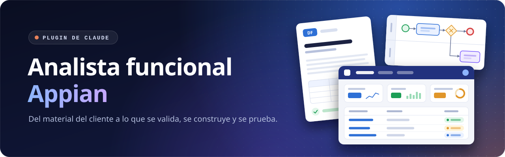

<!-- Portada del repositorio en GitHub. No va en el paquete (.github/ es del repositorio): el manual del plugin es el README.md de la raíz. -->

<div align="center">



<br>

**Del material del cliente al diseño funcional que valida y a lo que se construye, se prueba y pasa a producción en
Appian.**

[](../README.md#versiones)
[](https://github.com/raulogm077/analista-funcional-appian/actions/workflows/pruebas.yml)


[Instalación](#instalación) · [Actualizaciones](#actualizaciones) · [Skills](#las-siete-skills) · [Cómo trabaja](#cómo-trabaja) · [Desarrollo](#desarrollo) · [Manual completo](../README.md)

</div>

---

## Qué es

Un plugin de Claude para equipos que analizan, documentan, rehacen, construyen y prueban aplicaciones **Appian**. Sirve
para cualquier proceso y cualquier cliente: el dominio sale siempre de las fuentes del proyecto.

- **Entra** lo que hay: reuniones, correos, actas, diagramas, el DF del cliente o una aplicación que ya existe.
- **Sale** lo que se necesita: el **DF en Word** que valida el cliente, la **especificación técnica**, los **procesos
  BPMN** en draw.io, un **prototipo navegable** con la marca del cliente y, por cada cambio aprobado, sus **issues de
  construcción** y su **QA** con SAIL CLI.
- **Cada reunión nueva** cambia solo lo afectado, con un informe de impacto que aprueba el analista.

## Instalación

Se hace una sola vez por persona. Después, el plugin se actualiza solo.

**1. Comprueba que tienes Git.** Claude Code lo usa para descargar el plugin de GitHub. Abre una terminal y escribe:

```bash
git --version
```

Si no lo reconoce, instálalo:

| Windows | macOS | Linux |
|---|---|---|
| `winget install Git.Git` | `xcode-select --install` | `sudo apt install git` |

**2. Instala el plugin en Claude Code:**

```text
/plugin marketplace add raulogm077/analista-funcional-appian
/plugin install appian-analisis-funcional@appian-analisis-funcional
```

**3. Activa las actualizaciones automáticas.** En Claude Code escribe `/plugin` → **Marketplaces** →
`appian-analisis-funcional` → **Enable auto-update**. Viene desactivado por defecto.

**4. Comprueba tu equipo.** Pide a Claude: *«comprueba qué le falta al plugin en este equipo»*. Te dice qué falta, qué
se pierde sin ello y cómo se instala ([tabla de requisitos](../README.md#requisitos)).

<details>
<summary><b>En la app de Claude (escritorio o web)</b></summary>

<br>

**Customize** → **Plugins** → **Add** → **Add marketplace** → **Add from repository** y escribe
`raulogm077/analista-funcional-appian`.

Ingeniería inversa y el QA necesitan en tu equipo el Dev MCP y SAIL CLI, así que solo funcionan con Claude Code (también
en la pestaña Code de la app de escritorio).

</details>

## Actualizaciones

| Cómo lo tienes | Qué pasa cuando sale una versión |
|---|---|
| Con auto-update | Llega sola: se aplica la próxima vez que abres Claude Code |
| Sin auto-update | `/plugin marketplace update appian-analisis-funcional` en una sesión, o `claude plugin update appian-analisis-funcional@appian-analisis-funcional` en la terminal |

¿Qué versión tienes? `claude plugin list`. Las novedades de cada versión están en el
[historial](../README.md#versiones).

## Las siete skills

Cada petición entra por una sola skill; las demás se usan desde ella y se pasan el trabajo en ficheros del proyecto.

| Skill | Para qué sirve | Entrega |
|---|---|---|
| `appian-reverse-engineering` | Documentar cómo está hecha una aplicación que ya existe, leyéndola en solo lectura por el Dev MCP, y verificar lo construido contra el técnico | `as-is/`: funcional, datos, seguridad, procesos, pantallas, reglas… con su evidencia |
| `appian-refactorizacion` | Plantear cómo debería estar hecha, entera o una parte, con buenas prácticas | `refactorizacion/propuesta.md`: diagnóstico, solución por capas, migración y hoja de ruta |
| `appian-functional-analyst` | Convertir las fuentes en el análisis funcional y la especificación técnica; llevar cada cambio como unidad, con sus issues, y las urgencias | DF en Word para el cliente, `analisis/tecnico.md` y las issues de `construccion/<U>/` |
| `appian-diagramas-bpmn` | Dibujar los procesos con notación BPMN y un carril por perfil, editables en la reunión | `.drawio`, PNG y BPMN 2.0 |
| `appian-prototipos` | Prototipos navegables con componentes SAIL reales y la marca del cliente o la de Appian | `prototipo/` navegable y capturas para el DF |
| `appian-best-practices` | Las buenas prácticas oficiales de Appian para diseñar, construir cada issue, revisar y diagnosticar | Decisiones de solución, reglas por dominio y quality gates |
| `appian-qa` | Recorrer los escenarios de una unidad construida con SAIL CLI como cada rol, en otra sesión | Guiones en `qa/<U>/` que se repiten sin IA antes de cada paquete |

Incluye el MCP público de documentación de Appian: lo que una skill no sabe con certeza, lo consulta antes de
escribirlo.

## Cómo trabaja


El detalle, con la estructura de cada proyecto y sus nueve flujos, está en el [manual](../README.md#cómo-trabaja).

## Desarrollo


Los pasos y las reglas del repositorio están en [`CLAUDE.md`](../CLAUDE.md): `main` está protegida y nada entra sin PR
ni sin las pruebas en verde.

<div align="center">
<br>
<sub>Todo el detalle (requisitos, empaquetado, confidencialidad y versiones) está en el <a href="../README.md">manual del plugin</a>.</sub>
</div>
